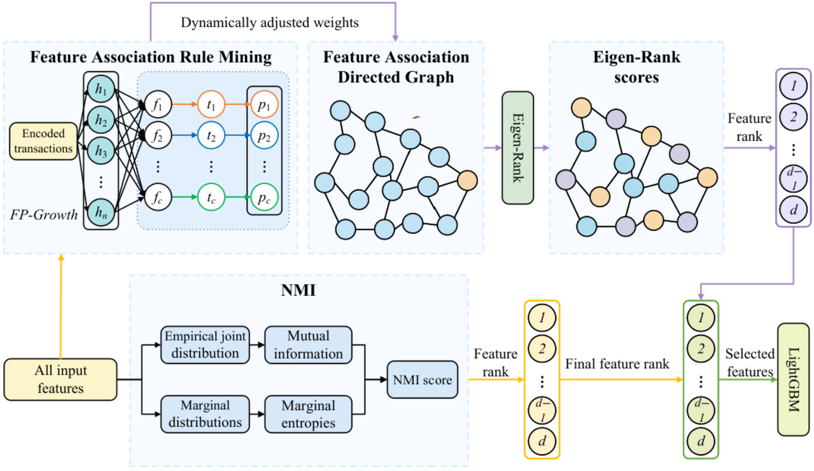
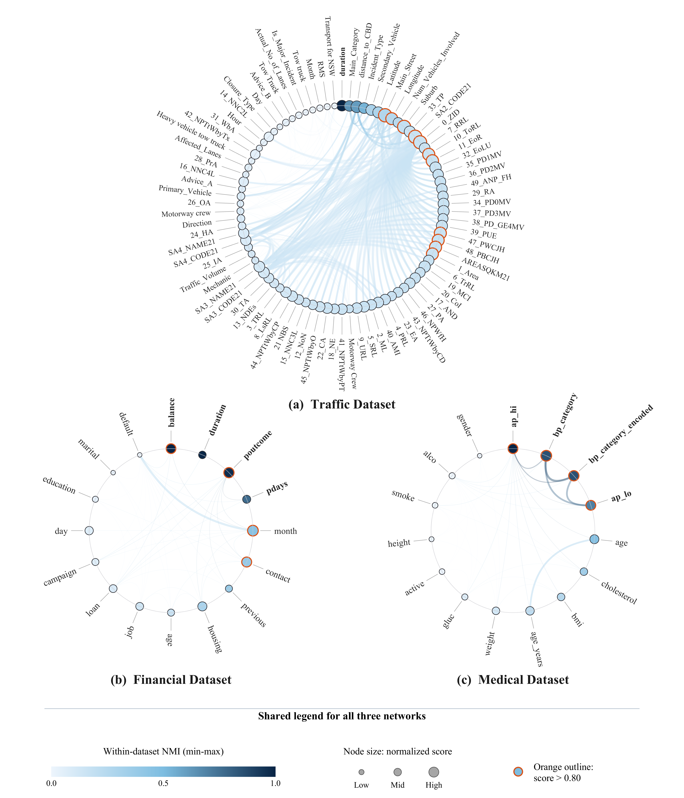

<div align="center">

# CNFI-NMI

**A Robust Feature Selection Framework Integrating Complex Network Interactions and Normalized Mutual Information**

Xiaoming Li · Nuoyan Xu · Li Shen · Yao Huang · Xincheng Wang · Yingjie Xu · Wanghao Wu · Guangquan Xu · Liangchen Liu

Accepted manuscript · *Big Data Mining and Analytics* · BDMA-2026-0010

[Method-to-code map](docs/METHODOLOGY.md) · [Reproducibility protocol](docs/REPRODUCIBILITY.md) · [中文说明](README_zh-CN.md)

</div>



## Overview

CNFI-NMI ranks tabular features by combining two complementary signals:

1. **CNFI** mines pairwise association rules, fuses Confidence, Lift, Support,
   Conviction, and Leverage through the validated dynamic-threshold logistic
   weighting mechanism, builds a weighted directed feature network, and applies
   Eigen-Rank.
2. **NMI** measures scale-normalized feature-target relevance for every input
   feature, independently of the CNFI ranking.
3. **Rank fusion** matches both full rankings by feature identity and combines
   their normalized rank scores with alpha = 0.5 by default. Only then are the
   requested top features retained.

The maintained implementation follows the revised method, exposes intermediate
rules/graphs/scores for audit, and is compatible with scikit-learn pipelines.
“Dynamic thresholding” denotes the existing logistic transition: theta is its
center, kappa its steepness, and the rule-specific lambda changes with Lift. It
does not introduce another threshold variable or change the fixed FP-Growth
support and confidence filters.

Rank scores use `(d - rank) / (d - 1)` for `d > 1` and zero for a single
feature. The default `graph_mode="normalized"` implements the manuscript's
min-max-scaled rule metrics and column-stochastic Eigen-Rank operator. The
historical `benchmark` mode must be requested explicitly and does not
implement the supplied manuscript. See [method mapping](docs/METHODOLOGY.md)
and [consistency audit](docs/PAPER_CONSISTENCY_AUDIT_zh-CN.md).

Empirical NMI can be inflated for high-cardinality features.

## Installation

```bash
git clone https://github.com/xux06814-cell/CNFI-NMI.git
cd CNFI-NMI
python -m pip install -e ".[test]"
pytest
```

For the LightGBM experiment runner:

```bash
python -m pip install -e ".[experiments,test]"
```

## Quick start

```python
import pandas as pd
from cnfi_nmi import CNFINMISelector

X = pd.read_csv("features.csv")
y = X.pop("target")

selector = CNFINMISelector(
    n_features_to_select=12,  # paper's optional k_max
    alpha=0.5,
    min_support=0.01,
    min_confidence=0.1,
    n_bins=5,
    graph_mode="normalized",
)
X_selected = selector.fit_transform(X, y)

print(selector.selected_features_)
print(selector.feature_scores_)
```

Run the example with your processed CSV:

```bash
python examples/quickstart.py --csv path/to/processed.csv --target target --features 12
```

## Experiments

The repository provides the selector, a five-fold LightGBM evaluation script,
and an alpha-sensitivity sweep. The evaluation runner requires an explicit
`--positive-label` so recall, F1 and AUC refer to the intended class. Supply your processed data and retain the
result files generated by your run. [Experiment settings](docs/REPRODUCIBILITY.md)
and [dataset definitions](data/README.md) describe the inputs and evaluation.



## Sensitivity analysis and MATLAB figures

See [Figure 5 sensitivity and Figure 6 visualization](docs/FIGURES_AND_SENSITIVITY.md)
for the alpha-sweep command, per-fold measurements, mean and sample SD exports,
and MATLAB plotting instructions. The plotting scripts read the result
directory you explicitly select.

## Repository layout

```text
src/cnfi_nmi/       maintained selector implementation
tests/              equation and API regression tests
scripts/            five-fold evaluation and exploratory alpha sweep
matlab/             figures generated from supplied measured CSV results
examples/           quick start with a user-supplied CSV
docs/               method mapping and reproducibility protocol
paper/              manuscript provenance and availability notice
data/               provenance requirements; raw data are not redistributed
legacy/             original two-file snapshot for auditability
```

## Citation

Use the repository's `CITATION.cff`. Until final bibliographic metadata and a
DOI are assigned, cite the accepted manuscript as:

```bibtex
@article{li2026cnfinmi,
  title   = {CNFI-NMI: A Robust Feature Selection Framework Integrating Complex Network Interactions and Normalized Mutual Information},
  author  = {Li, Xiaoming and Xu, Nuoyan and Shen, Li and Huang, Yao and Wang, Xincheng and Xu, Yingjie and Wu, Wanghao and Xu, Guangquan and Liu, Liangchen},
  journal = {Big Data Mining and Analytics},
  year    = {2026},
  note    = {Accepted manuscript, BDMA-2026-0010}
}
```

## License

A software license has not yet been specified. Citation metadata is in `CITATION.cff`.
