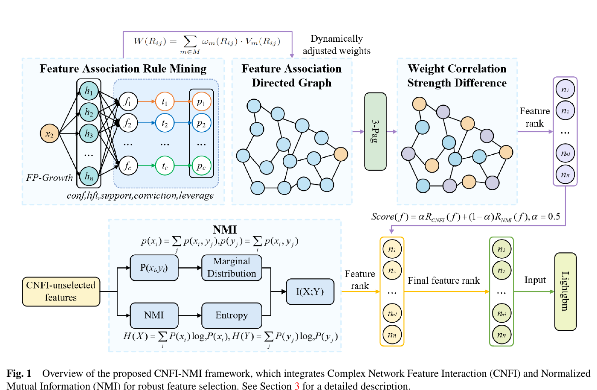
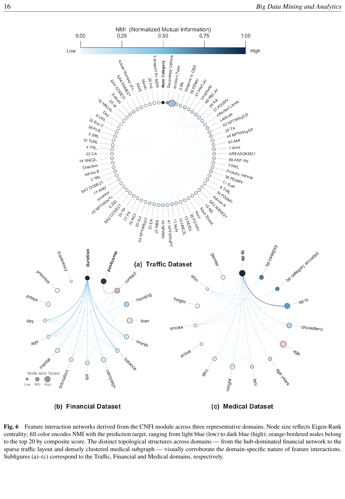

<div align="center">

# CNFI-NMI

**A Robust Feature Selection Framework Integrating Complex Network Interactions and Normalized Mutual Information**

Xiaoming Li · Nuoyan Xu · Li Shen · Yao Huang · Xincheng Wang · Yingjie Xu · Wanghao Wu · Guangquan Xu · Liangchen Liu

Accepted manuscript · *Big Data Mining and Analytics* · BDMA-2026-0010

[Paper](paper/BDMA-2026-0010.pdf) · [Method-to-code map](docs/METHODOLOGY.md) · [Reproducibility protocol](docs/REPRODUCIBILITY.md) · [中文说明](README_zh-CN.md)

</div>



## Overview

CNFI-NMI ranks tabular features by combining two complementary signals:

1. **CNFI** mines pairwise association rules, fuses Confidence, Lift, Support,
   Conviction, and Leverage with adaptive weights, builds a weighted directed
   feature network, and applies Eigen-Rank.
2. **NMI** measures scale-normalized feature-target relevance for features not
   selected by CNFI.
3. **Rank fusion** combines both disjoint rankings with alpha = 0.5 by default.

The maintained implementation follows Eqs. (1)-(29), exposes intermediate
rules/graphs/scores for audit, and is compatible with scikit-learn pipelines.

## Installation

```bash
git clone https://github.com/xux06814-cell/CNFI-NMI.git
cd CNFI-NMI
python -m pip install -e ".[test]"
pytest
```

For the LightGBM experiment runner:

```bash
python -m pip install -e ".[experiments,test]"
```

## Quick start

```python
import pandas as pd
from cnfi_nmi import CNFINMISelector

X = pd.read_csv("features.csv")
y = X.pop("target")

selector = CNFINMISelector(
    n_features_to_select=12,  # paper's optional k_max
    cnfi_features=6,          # paper's user-specified k_f
    alpha=0.5,
    min_support=0.01,
    min_confidence=0.1,
    n_bins=5,
)
X_selected = selector.fit_transform(X, y)

print(selector.selected_features_)
print(selector.feature_scores_)
```

Run `python examples/quickstart.py` for a self-contained synthetic example.

## Scientific reproducibility

The repository distinguishes executable methodology from unverified numerical
reproduction. The exact raw archives, checksums, preprocessing decisions, fold
seeds, and full classifier search grids used for the manuscript figures were
not present in the original repository or supplied PDF. Therefore, this release
does **not** claim to regenerate the published numbers until those provenance
artifacts are added. See [the protocol](docs/REPRODUCIBILITY.md) and
[dataset checklist](data/README.md).



## Repository layout

```text
src/cnfi_nmi/       maintained selector implementation
tests/              equation and API regression tests
scripts/            leakage-safe five-fold experiment runner
examples/           synthetic quick start
docs/               method mapping and reproducibility protocol
paper/              accepted manuscript in its original layout
data/               provenance requirements; raw data are not redistributed
legacy/             original two-file snapshot for auditability
```

## Citation

Use the repository's `CITATION.cff`. Until final bibliographic metadata and a
DOI are assigned, cite the accepted manuscript as:

```bibtex
@article{li2026cnfinmi,
  title   = {CNFI-NMI: A Robust Feature Selection Framework Integrating Complex Network Interactions and Normalized Mutual Information},
  author  = {Li, Xiaoming and Xu, Nuoyan and Shen, Li and Huang, Yao and Wang, Xincheng and Xu, Yingjie and Wu, Wanghao and Xu, Guangquan and Liu, Liangchen},
  journal = {Big Data Mining and Analytics},
  year    = {2026},
  note    = {Accepted manuscript, BDMA-2026-0010}
}
```

## License

No software or manuscript license has been declared yet. All rights remain with
the respective authors and publisher until an explicit license file is added.
