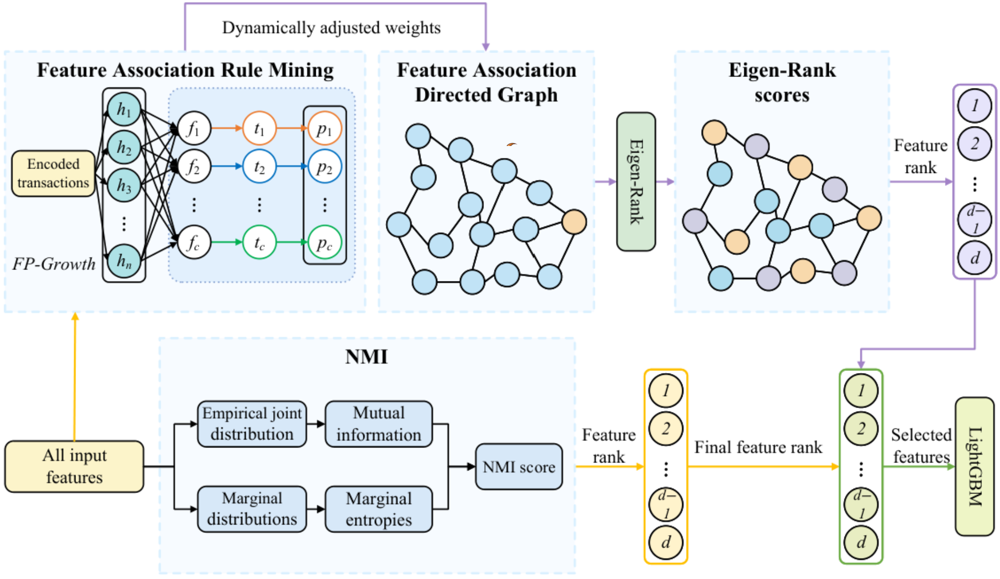

<div align="center">

# CNFI-NMI

**融合复杂网络交互与归一化互信息的稳健特征选择框架**

录用稿 · *Big Data Mining and Analytics* · BDMA-2026-0010

[方法与代码对应关系](docs/METHODOLOGY.md) · [复现实验规范](docs/REPRODUCIBILITY.md) · [English](README.md)

</div>



## 方法概述

CNFI-NMI 将两类互补信息融合为统一的特征排序：

1. **CNFI 阶段**：通过 FP-Growth 挖掘两两关联规则，使用已验证的动态阈值
   Logistic 机制融合置信度、提升度、支持度、确信度和杠杆率，构建加权
   有向特征网络，再使用 Eigen-Rank 计算交互重要性。
2. **NMI 阶段**：独立地对全部输入特征计算其与目标变量的归一化
   互信息，衡量非线性相关性。
3. **秩融合阶段**：CNFI 和 NMI 都给出全部输入特征的排序；先将两份
   排名按特征名称对应，再以 `alpha=0.5` 为默认权重融合秩得分，最后
   按 `n_features_to_select` 保留所需数量的特征。

## 安装与测试

```bash
git clone https://github.com/xux06814-cell/CNFI-NMI.git
cd CNFI-NMI
python -m pip install -e ".[test]"
pytest
python examples/quickstart.py --csv path/to/processed.csv --target target --features 12
```

## 与原文保持一致的关键点

- CNFI 连续变量采用 5 档等频离散化；NMI 使用未经 CNFI 离散化的原始列。
- PMI 代理严格使用 `log2(Lift)`，与原文统一以 bit 为单位。
- NMI 使用几何均值归一化，采用修订稿的定义。
- 秩得分严格实现 `(N-rank)/(N-1)`；单特征得分为 0。
- 默认参数 `min_support=0.01`、`min_confidence=0.1`、`alpha=0.5`、
  `kappa=1.0`、`theta=0.0` 以及两组先验权重均对应原文。
- “动态阈值”指现有 Logistic 过渡机制：`theta` 是过渡中心，`kappa`
  控制陡峭度，逐规则的 `lambda` 随 Lift 平滑变化，不引入新的阈值变量；
  FP-Growth 的支持度和置信度筛选阈值保持固定。消融项 “Dynamic thres.”
  即指该机制。
- 关联规则、网络、阶段得分和最终排序均作为拟合后属性公开，方便审计。

修订稿还给出了未用于已报告实验的归一化扩展，可通过
`graph_mode="normalized"` 启用；默认 `graph_mode="benchmark"` 保留
实验所用的原始指标和谱算子。经验 NMI 对高基数特征可能偏高。

## 实验运行

仓库提供特征选择器、五折 LightGBM 实验和 α 敏感性扫描。使用者传入自己的处理后数据，并保存本次运行生成的结果文件。输入定义见[数据说明](data/README.md)，验证流程和参数见[实验设置](docs/REPRODUCIBILITY.md)。

## 参数敏感性与 MATLAB 绘图

[使用说明](docs/FIGURES_AND_SENSITIVITY.md)包含 α 扫描、逐折指标、均值与样本标准差导出，以及 MATLAB 图 5、图 6 的运行方法。绘图脚本读取使用者明确指定的结果目录。

## 目录结构

```text
src/cnfi_nmi/       维护中的论文算法实现
tests/              公式与接口回归测试
scripts/            五折 LightGBM 实验及探索性 α 扫描
matlab/             读取实算 CSV 的论文图表脚本
examples/           读取使用者 CSV 的运行示例
docs/               方法映射与严格复现规范
paper/              论文来源与获取说明
data/               数据来源与校验要求（不直接分发原始数据）
legacy/             原仓库代码快照，仅供审计追溯
```

## 许可说明

软件许可证尚待作者确定；引用信息见 `CITATION.cff`。
