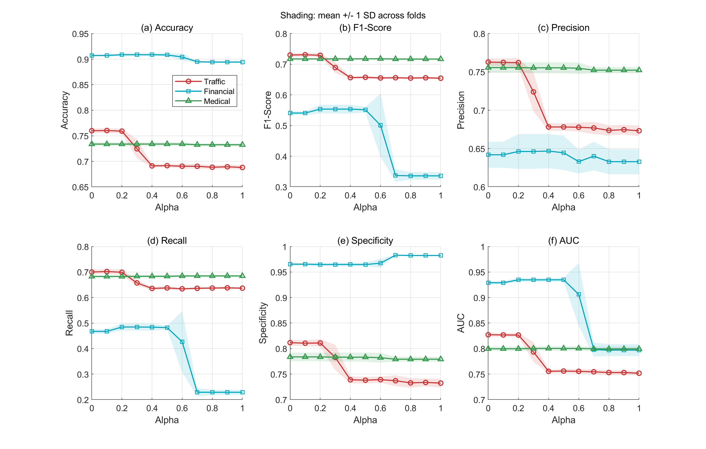
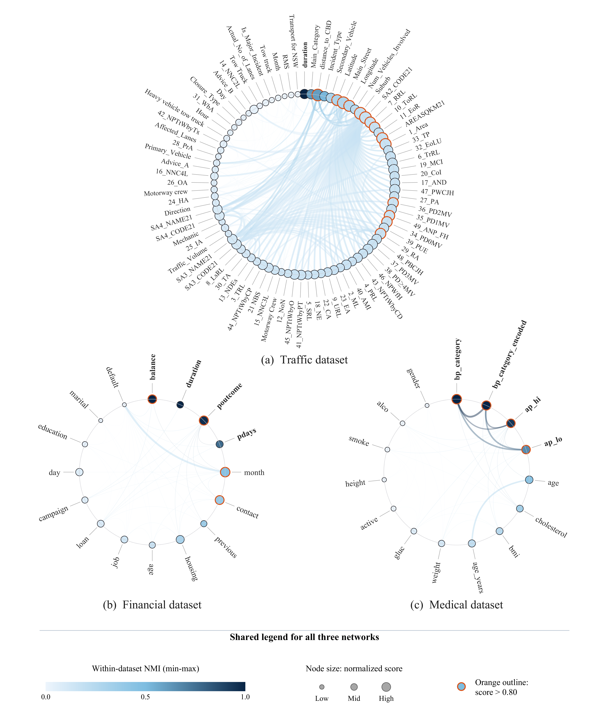
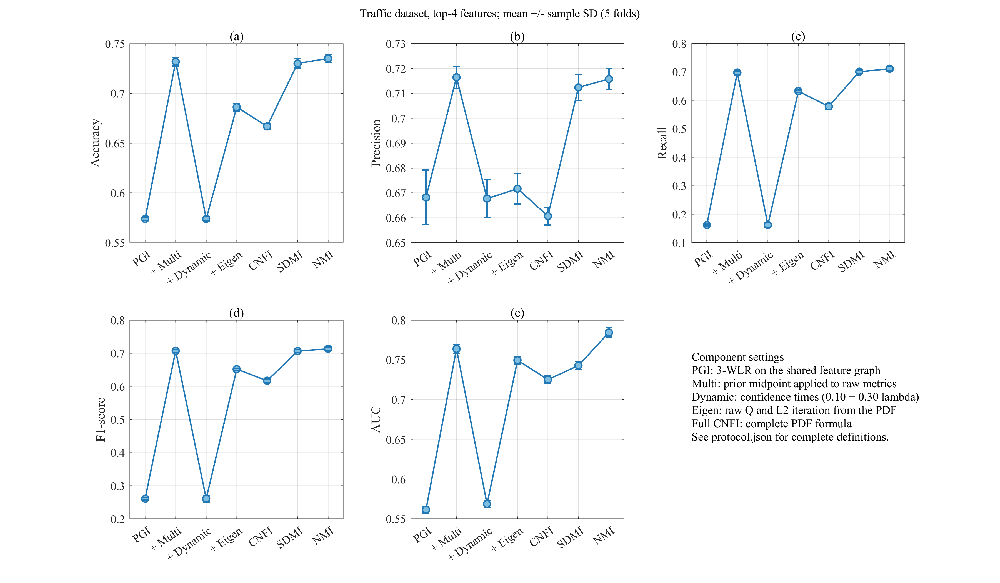

# Public-data experiment run, 15–16 November 2026

This directory contains measurements trained from newly downloaded source
archives with the supplied compiled manuscript's raw formulas. It includes all
three alpha sweeps and the seven-row traffic component experiment. The
manuscript's reference images remain in `docs/assets/`.

## Data and measured results

At alpha=.5, using top 12 fused features and five outer folds:

| Dataset | Rows | Inputs | AUC, mean ± sample SD | F1, mean ± sample SD |
|---|---:|---:|---:|---:|
| Traffic | 85,611 | 85 | .7560 ± .0040 | .6573 ± .0045 |
| Financial | 45,211 | 16 | .9348 ± .0039 | .5516 ± .0095 |
| Medical | 68,613 | 15 | .8003 ± .0043 | .7175 ± .0030 |

Financial dimensions match the manuscript. Traffic has 85 predictors after
merging and removing the two emergency-service fields; the manuscript reports
86. The explicit medical cleaning produces 68,613 rows, compared with the
reported 68,205. Definitions and source attribution are in
[data/README.md](../../data/README.md). These are public-data rerun measurements;
the traffic AUC differs from the manuscript's .8383.

The traffic component experiment uses top 4 features:

| Method | AUC, mean ± sample SD |
|---|---:|
| PGI on shared feature graph | .5614 ± .0042 |
| + Multi weight | .7637 ± .0057 |
| + Dynamic thresholding | .5687 ± .0046 |
| + Eigen-Rank | .7496 ± .0047 |
| Full CNFI | .7252 ± .0045 |
| SDMI | .7429 ± .0049 |
| NMI | .7844 ± .0060 |

Each component improves AUC over this PGI control in all five folds. Full CNFI
does not rank first in this run. The standalone Multi/Dynamic definitions and
the PGI feature-graph adaptation are specified in
[REPRODUCIBILITY.md](../../docs/REPRODUCIBILITY.md).
[ablation_paper_comparison.csv](ablation_paper_comparison.csv) retains the
manuscript means, reported SDs, measured means/SDs and differences for every
listed metric; reported and measured columns remain separate.

## Figures







Each figure also has a PDF with the same basename. The dataset directories
contain the exact plotting CSVs, directed networks, per-fold measurements,
selected features, train/test row indices and formula audits. The uncertainty
is sample SD across folds, rather than a confidence interval. Figure 6's weak
edge filtering and within-dataset visual scaling affect display only.

## Run and verify

The maintained commands in [the root README](../../README.md#experiments)
download, prepare and train new runs in a user-selected directory. MATLAB
templates require the result directory explicitly:

```matlab
repo = 'C:/path/to/CNFI-NMI';
setenv('CNFI_RESULTS_DIR', fullfile(repo, 'results', 'my-run'));
run(fullfile(repo, 'matlab', 'Fig5_sensitivity.m'));
run(fullfile(repo, 'matlab', 'Fig6_SharedLegend.m'));
run(fullfile(repo, 'matlab', 'Table5_ablation.m'));
```

To check the published records and file hashes from the repository root:

```bash
python scripts/verify_reference_results.py reproduction/public-data-20261116
```

`run_validation.json` checks the completed 165 sensitivity and 35 ablation
records, exact seed-42 folds, ranges, summaries and convergence.
`formula_verification.json` compares pair supports with FP-Growth and raw
Eigen-Rank with direct eigendecomposition using actual Bank observations.
`port_verification.json` records the maintained implementation's equality to
the executed overlay on each dataset's first-fold graph, NMI, fused ranking
and traffic component selections. These checks cover the formulas and result
files; performance values are the recorded outer-fold measurements.

`execution_snapshot/` preserves the exact source bytes used in the completed
run over upstream commit `3dd0549733f6d2038cd32963c7d7373839b35d54`.
Its overlay uses the name `PaperCNFINMISelector` and mode `paper_raw`; the
maintained port exposes this computation as `CNFINMISelector(graph_mode="paper")`.
The checkpoint contracts identify those original source hashes. Use the
maintained CLI for new runs. Source archive hashes and processed data hashes
are in `data_provenance.json`; executed library versions are in `environment.json`
and each `protocol.json`.
The manuscript is identified by SHA-256 rather than redistributed here.
